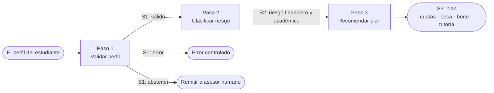
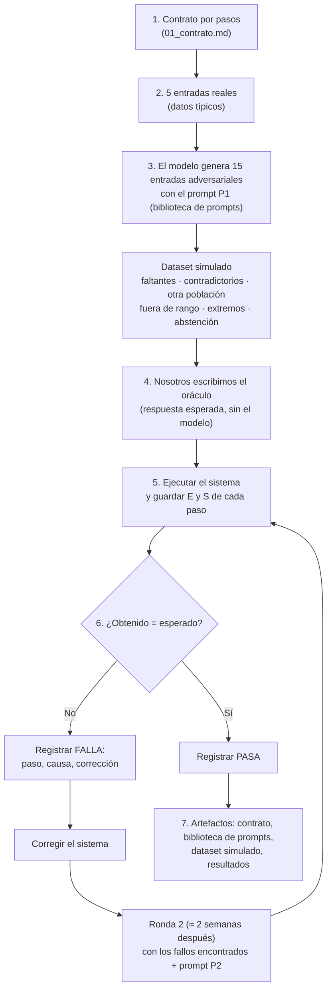

# 6. Diagramas

## A. El sistema por pasos (lo del tablero: E → 1 → 2 → 3, cada paso con su S)

## B. El proceso de la práctica

Para verlos como imagen: pega cada bloque en https://mermaid.live y exporta a PNG.
