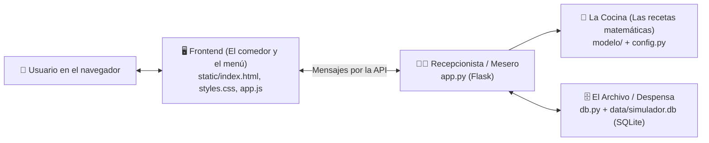

# Guía explicada desde cero — Cómo funciona todo el proyecto (sin tecnicismos)

Este documento explica **cada pieza del Simulador de Probabilidad de Deserción** como si estuvieras conversando con alguien que **nunca ha programado ni estudiado estadística**. Cada vez que aparece una palabra técnica, se traduce de inmediato al lenguaje de todos los días con un ejemplo cotidiano.

---

## 1. ¿Qué problema resuelve este sistema en la vida real?

Imagina la oficina de Bienestar de una universidad al empezar el semestre. Hay miles de estudiantes matriculados y algunos están a punto de abandonar su carrera (**desertar**), pero por razones muy distintas:
- Uno se está quedando sin dinero para pagar la matrícula (**problema financiero**).
- Otro reprueba materias y falta a clase (**problema académico**).
- Otro trabaja 45 horas a la semana en horarios que chocan con sus clases (**problema laboral**).
- Otro tarda 2 horas en bus para llegar, cuida familiares y no tiene red de apoyo (**problema personal**).

La universidad tiene recursos limitados (becas, acuerdos de pago, tutorías, horarios nocturnos, psicólogos). Si reparte ayudas al azar, desperdicia recursos; y si le da una tutoría de matemáticas a alguien cuyo verdadero problema es no tener para el bus, **esa ayuda no sirve**.

**¿Qué hace entonces nuestro programa?**
Recibe la información de un grupo de estudiantes, revisa que los datos tengan sentido, calcula **qué tan probable es que cada uno abandone este semestre**, explica **cuál es la causa principal** y propone **el plan de ayuda exacto** para ese estudiante.

---

## 2. ¿Cómo está construido el programa por dentro? (La analogía del restaurante)

En informática, una aplicación web se divide en partes para no mezclar todo. Piensa en un **restaurante**:



Aquí tienes qué significa cada palabra técnica y qué archivo cumple ese papel:

1. **Frontend ("lo de adelante" — `static/`):**
   Es todo lo que ves y tocas en la pantalla del navegador: botones, colores, tablas y gráficas. Se compone de tres archivos:
   - `index.html`: el **esqueleto** (define qué títulos, botones y tablas existen).
   - `styles.css`: la **pintura y decoración** (colores, tamaños, modo claro/oscuro, diseño ordenado).
   - `app.js`: los **reflejos de la página** (qué pasa cuando haces clic en un estudiante, cambias de pestaña o mueves una barra deslizante).

2. **Backend ("lo de atrás" — `app.py` y carpeta `modelo/`):**
   Es el cerebro que corre en tu computador detrás de escena, escrito en un lenguaje llamado **Python**. El usuario no ve este código, pero es quien hace todos los cálculos reales.

3. **API (*Interfaz de Comunicación* — dentro de `app.py`):**
   Es el **mesero** que lleva pedidos desde la pantalla (*frontend*) hacia el cerebro (*backend*) y trae la respuesta de vuelta. Por ejemplo, cuando pulsas *"Ejecutar simulación"*, la página le manda una notita al mesero (`/api/simulaciones`) usando un formato de texto ordenado llamado **JSON** (que es simplemente una lista de datos con nombre y valor, como `"semilla": 42`). **Flask** es la herramienta liviana de Python que hace de mesero.

4. **Archivo de configuración (`config.py`):**
   Es el **libro maestro de reglas y medidas**. En lugar de esconder números por todo el programa, absolutamente todos los topes, pesos y ayudas posibles están escritos aquí en un solo sitio. Si mañana la universidad cambia una regla, solo se edita este archivo.

5. **Base de datos SQLite (`db.py` y `data/simulador.db`):**
   Una **base de datos** es un archivador digital súper organizado donde se guarda el historial para que no se borre al apagar el computador. **SQLite** es un tipo de base de datos que guarda todo dentro de un único archivo (`simulador.db`), sin necesitar instalar programas pesados aparte. Tiene 3 cajones (*tablas*):
   - `simulaciones`: guarda el resumen general de cada corrida que hiciste.
   - `estudiantes`: guarda la ficha de datos personales/académicos de cada estudiante evaluado.
   - `resultados`: guarda la probabilidad calculada y las ayudas asignadas (solo de quienes tenían datos válidos).

6. **Entorno virtual (`.venv`):**
   Es una **cajita aislada** donde instalamos únicamente las dos herramientas que necesita nuestro proyecto (`flask` para el servidor web y `pytest` para hacer pruebas), sin ensuciar ni desconfigurar el resto de tu computador.

---

## 3. ¿De dónde salen los estudiantes que vemos en pantalla?

En la vida real, las notas, deudas e ingresos de los estudiantes son datos privados protegidos por ley. Por eso el simulador puede trabajar con **dos tipos de fuentes** (que eliges arriba en la página con un clic):

### A. Estudiantes simulados o "sintéticos" (`modelo/generador.py`)
"Sintético" significa **creado artificialmente por el computador imitando la realidad**. No corresponde a ninguna persona de carne y hueso, pero tampoco son números locos al azar: el generador respeta relaciones lógicas reales (por ejemplo, si un hogar tiene menos ingresos, es más probable que el estudiante trabaje más horas; si trabaja demasiadas horas, suele bajar su asistencia; y si baja su asistencia, suele bajar su promedio).

Aquí aparece dos veces una palabra famosa:
- **¿Qué es Montecarlo?** Suena sofisticado (viene del famoso casino de Mónaco), pero significa simplemente **usar sorteos repetidos con dados cargados de forma realista**. En esta primera parte (*Montecarlo 1*), el computador "tira los dados" 500 veces siguiendo esas reglas realistas para inventar una **cohorte** (un grupo de 500 estudiantes de prueba).
- **¿Qué es la Semilla (`semilla = 42`)?** En los computadores, los sorteos tienen un truco: si le das un número clave llamado **semilla**, el sorteo sale **exactamente igual siempre**. Eso es vital para una entrega universitaria: si tú pones semilla `42` en tu casa y el profesor pone semilla `42` en su oficina, a ambos les saldrán **exactamente los mismos 500 estudiantes con las mismas décimas**.
- **¿Qué es SPADIES 3.0?** Es el sistema oficial del Ministerio de Educación de Colombia que mide cuántos universitarios abandonan sus estudios en el país (actualmente el **8,65% al año**, que equivale a **4,42% por semestre**). El botón *SPADIES MEN* ajusta el simulador a esa cifra oficial colombiana.

### B. Estudiantes reales de un estudio público (`modelo/datos_reales.py`)
Para demostrar que nuestras fórmulas también funcionan con personas reales, incluimos un archivo público internacional (**Dataset Real UCI**, publicado por investigadores en Portugal con **3.630 estudiantes reales** anónimos de quienes ya se sabe si terminaron graduándose o desertando). Este módulo "traduce" sus notas y datos económicos al formato de Colombia (notas de 0 a 5, pesos colombianos, estratos) y los pasa por nuestro sistema.

---

## 4. El corazón del sistema: Los 3 pasos que recorre cada estudiante

Cada estudiante entra por una tubería de **3 estaciones en fila**, igual que el triaje de una clínica:

```
Ficha del estudiante (14 datos) ──▶ [ Paso 1: Revisar datos ] ──▶ [ Paso 2: Medir riesgo ] ──▶ [ Paso 3: Asignar ayuda ]
```

### Paso 1: El guardia en la puerta (`modelo/validacion.py`)
Antes de hacer cuentas, el programa revisa un **contrato** (una lista estricta de reglas sobre qué datos son aceptables). Cada estudiante debe traer **14 datos obligatorios** (promedio, materias perdidas, asistencia, semestre, deuda, ingreso familiar en salarios mínimos SMMLV, estrato, si tiene beca, horas de trabajo, si trabaja en lo que estudia, minutos de viaje, personas a cargo, apoyo familiar de 1 a 5 y si es el primero de su familia en ir a la universidad).

El guardia revisa 4 cosas en orden:
1. **¿Falta algún dato?** (Ej. dejaron el promedio en blanco).
2. **¿El formato está mal?** (Ej. escribieron `"tres"` con letras donde iba un número, o se coló un error matemático llamado `NaN` — *"Not a Number"*, un valor roto que producen a veces los computadores).
3. **¿Se sale de los límites posibles?** (Ej. promedio `6.3` cuando la nota máxima es `5.0`, o estrato `9`).
4. **¿Hay una contradicción absurda?** Por ejemplo:
   - Tener promedio perfecto de `5.0` y al mismo tiempo decir que perdió `2` materias.
   - Vivir en estrato 6 con ingresos casi en cero, o el famoso **Caso A03**: decir que es **estrato 1 pero gana 14 salarios mínimos al mes** (un caso engañoso descubierto en las pruebas de estrés anteriores).

> **Regla de oro del Paso 1:** Si un estudiante falla cualquiera de esas 4 revisiones, **el programa se detiene ahí mismo para ese caso**. No inventa un cero para rellenar ni le calcula probabilidad: lo marca como **"Revisión humana"** con una nota explicando el problema para que un asesor de carne y hueso revise sus papeles. (En los 500 estudiantes simulados se meten a propósito **15 fichas con errores — el 3% —** para demostrar en vivo que este guardia sí los atrapa).

---

### Paso 2: Calcular la probabilidad de abandono (`modelo/riesgo.py` e `incertidumbre.py`)

Si la ficha del estudiante está limpia, pasa a la calculadora de riesgo, que trabaja en **4 etapas sencillas**:

#### 2A. Sacar 4 "notas de alerta" por área (*Subpuntajes*)
El programa agrupa los 14 datos en las **4 dimensiones** de la vida del estudiante (*Académica, Financiera, Laboral y Personal*) y calcula para cada una un número entre **0 y 1**:
- **0.00** significa *"todo perfecto en esta área, cero peligro"*.
- **1.00** significa *"alerta máxima en esta área"*.
- Si en algún área el estudiante saca **0.60 o más**, el sistema le pone una banderita de **"Dimensión con problema" (⚠)**.
- *Concepto técnico — **Saturación**:* Significa poner un tope razonable para no exagerar. Por ejemplo, deber 8 millones de pesos en matrícula ya es una crisis financiera máxima (`1.0`); deber 15 millones sigue contando como alerta máxima (`1.0`) en esa regla.

#### 2B. Juntar las 4 áreas con una "Regresión Logística"
Aquí aparece el nombre más intimidante del proyecto, pero la idea es muy simple:
- **¿Qué es el Logit (`z`)?** Es una **suma con importancia distinta para cada área**. Como en la literatura educativa los problemas académicos y de dinero empujan más al abandono que los demás, les damos más peso:
  - Académica se multiplica por **3.0**
  - Financiera se multiplica por **2.5**
  - Laboral se multiplica por **1.5**
  - Personal se multiplica por **1.2**
  A esa suma se le añade un número base llamado **`b₀`** (que suele ser negativo, como `-4.95`, porque por fortuna la mayoría de los estudiantes **no** abandona). El resultado total de esa suma se llama **logit (`z`)**.
- **¿Qué es la Regresión Logística?** Como esa suma `z` puede dar números raros como `-3.2` o `+1.8`, la **función logística** actúa como un **embudo suave en forma de S** que convierte cualquier resultado `z` en una **probabilidad limpia entre 0% y 100%** (`p`). Mientras más grande sea `z`, más cerca de 100% queda la probabilidad de desertar.

#### 2C. Ajustar el termostato con la realidad (*Calibración de `b₀` por bisección*)
- **¿Qué es calibrar `b₀`?** Nosotros elegimos los pesos `3.0, 2.5, 1.5, 1.2` con juicio experto, pero necesitamos que el **promedio de riesgo de todo el grupo** coincida con la deserción real de la universidad (por ejemplo, **9,0%** en primer año o **4,42%** nacional en SPADIES). Para lograrlo sin hacer trampa, el programa ajusta automáticamente ese punto de partida `b₀`.
- **¿Qué es el método de bisección?** Es literalmente jugar a **"más frío o más caliente"** partiendo a la mitad: el computador prueba un `b₀` en la mitad; si el riesgo promedio salió muy bajo (ej. 3%), sube a la mitad superior; si salió muy alto (ej. 20%), baja a la mitad inferior. Repitiendo eso unas 50 veces en milésimas de segundo, clava el promedio exacto en **9,000000%**.

#### 2D. Reconocer que no somos adivinos (*Incertidumbre P5–P95 con Montecarlo 2*)
Como los pesos (`3.0, 2.5...`) fueron propuestos por expertos y no medidos con diez años de historia de la universidad, ¿qué pasaría si en realidad el peso financiero fuera un poquito más alto o más bajo?
- Aquí usamos **Montecarlo por segunda vez**: para cada estudiante, el computador recalcula su probabilidad **1.000 veces** agitando ligeramente esos pesos (±25% hacia arriba y hacia abajo).
- De esos 1.000 resultados ordenados de menor a mayor, descarta el 5% más bajo y el 5% más alto, y nos entrega el **rango central del 90%**, llamado **intervalo P5–P95** (Percentil 5 a Percentil 95).
- **En cristiano:** En vez de decir con arrogancia *"Pedro tiene exactamente 28,4% de riesgo"*, el sistema dice *"Estimamos **28,4%**, y moviendo razonablemente los supuestos estaría **entre 19% y 39%**"*.

---

### Paso 3: Clasificar el nivel y recetar la ayuda (`modelo/intervencion.py`)

Con la probabilidad `p` lista, el semáforo clasifica al estudiante en tres niveles (por defecto):
- **Verde — Riesgo Bajo** (`p` menor a `15%`): No requiere intervención activa.
- **Amarillo — Riesgo Medio** (`p` entre `15%` y `35%`): Entra a acompañamiento **solo si tiene al menos un área crítica (`≥ 0.60`)**.
- **Rojo — Riesgo Alto** (`p` de `35%` en adelante): **Siempre** entra a acompañamiento prioritario.

**¿Qué ayuda se le asigna y en qué orden?**
- Por cada área que esté en alerta (`≥ 0.60`), se activa su paquete específico:
  - *Académica* → Tutoría par y plan de recuperación con docente guía.
  - *Financiera* → Matrícula en 4 cuotas sin interés, beca de alimentación y bono de transporte.
  - *Laboral* → Reubicación de horario y asignaturas en jornada nocturna.
  - *Personal* → Cita con Bienestar Universitario y red de apoyo entre pares.
- Se pone como **Prioridad 1** el **Factor Principal** (el área que más empujó hacia arriba su riesgo). Y si alguien llegó a *Riesgo Alto* acumulando un poquito de todo sin que ninguna sola área pasara de `0.60`, igual se le asigna la ayuda de su *Factor Principal* para que nunca se quede con las manos vacías.

---

## 5. Guía visual de la página web (Qué hace cada sección en pantalla)

Cuando abres `http://127.0.0.1:5000`, la pantalla está organizada para ir de lo general a lo individual:

### A. Barra superior de comando
- **Píldoras de escenario rápido:** 4 botones listos para cambiar en un clic entre datos simulados (*Referencia 9%*, *SPADIES 4,42%*) y datos reales (*UCI Completo 3.630*, *Muestra UCI 500*).
- **Botón `⚙ Parámetros`:** Abre un cajón si quieres personalizar tú mismo cuántos estudiantes evaluar, cambiar la semilla o mover los umbrales del semáforo.
- **Botón `☾ / ☀`:** Cambia entre modo claro y modo oscuro (ideal para proyectar en un salón).

### B. Pestaña 1 — Panorama y Estudiantes
1. **6 Tarjetas de indicadores (*KPIs — Indicadores Clave*):** Muestran de un vistazo el riesgo medio del grupo, cuántos están en Alto/Medio/Bajo, cuántos necesitan ayuda y cuántos fueron a Revisión Humana. *Truco útil: si haces clic en cualquiera de esas tarjetas, la tabla de abajo se filtra sola.*
2. **Gráfica izquierda (Histograma):** Es una foto de cuántas personas cayeron en cada escalón de riesgo, con líneas punteadas marcando dónde empieza el riesgo Medio y el Alto. Cuando miras el **Dataset Real UCI**, te separa en colores quiénes en la vida real terminaron **desertando (rojo)** y quiénes **se graduaron (verde)**, dejando ver claramente que los que desertaron de verdad se concentran hacia la derecha.
3. **Gráfica derecha (Aporte por dimensión):** Muestra cuál de las 4 áreas está pesando más en toda la universidad y cuántos alumnos tienen alerta allí.
4. **Tabla inteligente con *Sparkbars* (mini-barritas):** Muestra de a 25, 50 o 100 estudiantes por página para que nunca se ponga lenta, con buscador por código, descarga a Excel (**CSV**) y pequeñas barras de progreso debajo de cada puntaje para detectar problemas con solo mirar.
5. **Panel lateral derecho (*Inspector del estudiante*):** Al hacer clic en cualquier fila de la tabla, se desliza desde la derecha una ficha clínica sin hacerte perder el lugar donde ibas leyendo. Incluye dos dibujos automáticos muy fáciles de explicar:
   - **Radar 4D (telaraña):** Un diamante de 4 puntas. Si una punta se sale del anillo rojo punteado (`0,60`), esa dimensión está en zona crítica.
   - **Cascada del Logit:** Escalones que muestran visualmente cómo se arrancó abajo en `b₀` y cuánto fue sumando cada dimensión hasta llegar a la probabilidad final.

### C. Pestaña 2 — Simulador de Acompañamiento (*What-If* / "¿Qué pasaría si…?")
Te permite jugar en vivo con las 14 variables de un estudiante usando barras deslizantes (*sliders*):
- Puedes probar **casos extremos** con un clic (incluidos los casos trampa del Paso 1 para ver cómo el guardia los rechaza al instante).
- Mejor aún: desde el panel lateral de cualquier estudiante en riesgo puedes pulsar **`Simular acompañamiento →`**. Eso carga a ese estudiante real o simulado y te deja pulsar **`✨ Simular efecto de apoyo institucional`** (o mover tú mismo su deuda y su beca) para ver el cuadro **ANTES vs. SIMULADO AHORA** (por ejemplo: bajar su riesgo de **39% Alto** a **12% Bajo**).

### D. Pestaña 3 — Validación del Modelo (¿Por qué creerle a las fórmulas?)
Reúne las **5 pruebas científicas** que demuestran que el modelo no inventa disparates:
1. **Validación empírica real (solo cuando abres el Dataset UCI):**
   - **Curva ROC y AUC–ROC (`0,8936`):** Es la nota universal para medir qué tan bueno es un detector separando dos grupos. Un `0,50` significa adivinar tirando una moneda; `1,00` es perfección absoluta. Sacar **`0,8936`** sobre 3.630 casos reales demuestra un poder de acierto muy alto.
   - **Matriz de Confusión (cuadrícula 2×2):** Cruza lo que dijo el simulador contra lo que pasó en la vida real:
     - *Verdaderos Positivos:* Desertaron en la realidad y el simulador **sí** encendió la alarma a tiempo.
     - *Verdaderos Negativos:* Se graduaron bien y el simulador **no** encendió falsas alarmas.
     - *Falsos Positivos:* Se graduaron, pero parecían en riesgo (recibirían apoyo preventivo, lo cual no les hace daño).
     - *Falsos Negativos:* Desertaron sin que su ficha mostrara señales fuertes en nuestras variables.
2. **Calibración:** Comprueba con números que el promedio calculado coincide al milímetro con la tasa objetivo.
3. **Sensibilidad (*Diagrama de Tornado*):** Mueve cada peso un 50% hacia abajo y hacia arriba para ver qué supuesto altera más el resultado global. Aquí sale un hallazgo muy interesante: aunque el peso académico (`3.0`) es mayor que el financiero (`2.5`), **el financiero mueve el triple el resultado general**, porque en nuestra población hay muchos más estudiantes con dificultades de bolsillo que con malas notas.
4. **Validez de cara (*Perfiles testigo*):** Evalúa a 3 estudiantes "arquetipo" (uno ideal sin ningún problema, uno con crisis solo de dinero y uno crítico en todo) y verifica que el veredicto coincida con el sentido común.
5. **Monotonía (*13 minicurvas*):** Verifica una ley básica de coherencia: si empeoras cualquier dato de un estudiante (le bajas el promedio, le subes la deuda o le subes las horas de trabajo), **su riesgo jamás puede disminuir**. Las 13 líneas suben siempre sin excepción.

### E. Pestaña 4 — Historial SQLite y Pruebas Automáticas (`tests/`)
- **Historial:** Lista todas las corridas guardadas en el archivo `simulador.db`. Si cierras el programa y lo abres mañana, siguen ahí listas para reabrirse con un clic.
- **Carpeta `tests/` (`347 pruebas con pytest`):** Son **347 robots inspectores** que en 2 segundos verifican automáticamente todas las fórmulas, bordes, errores maliciosos, base de datos y respuestas del servidor para garantizar que ningún cambio rompa el sistema.

---

## 6. Diccionario de bolsillo (para traducir rápido cualquier término)

| Término técnico | Traducción sencilla en una frase |
| :--- | :--- |
| **Cohorte** | El grupo completo de estudiantes evaluados en una simulación (ej. 500 alumnos). |
| **Datos sintéticos** | Fichas de estudiantes ficticios generadas con reglas realistas para proteger la privacidad. |
| **Contrato (Paso 1)** | Las reglas mínimas de calidad que debe cumplir una ficha antes de calcularle nada. |
| **Subpuntaje (`sA, sF, sL, sP`)** | Calificación de alerta de `0` (sin problema) a `1` (problema máximo) en cada una de las 4 áreas. |
| **Logit (`z`)** | El puntaje bruto que resulta de sumar las 4 alertas multiplicadas por su importancia más `b₀`. |
| **Regresión logística** | La fórmula en forma de "S" que traduce el puntaje `z` a una probabilidad entre `0%` y `100%`. |
| **Calibración de `b₀` (Bisección)** | Ajustar automáticamente el punto de partida para que el riesgo promedio del grupo iguale la tasa real. |
| **Montecarlo** | Hacer cientos de sorteos controlados (se usa para inventar la cohorte y para medir el margen de duda). |
| **Intervalo P5–P95** | La franja honesta de incertidumbre donde cae el 90% de los cálculos al mover los supuestos ±25%. |
| **Semilla (`semilla = 42`)** | Código numérico que congela el azar para que el experimento dé exactamente igual en cualquier PC. |
| **AUC–ROC (`0,8936`)** | Calificación de 0,5 a 1,0 de qué tan bien distingue el modelo a un desertor real frente a un graduado real. |
| **Frontend / Backend / API** | La pantalla visible (`static/`) / El motor que calcula (`modelo/`) / El mensajero entre ambos (`app.py`). |
| **SQLite** | El archivo local (`simulador.db`) donde quedan guardadas todas las simulaciones realizadas. |
