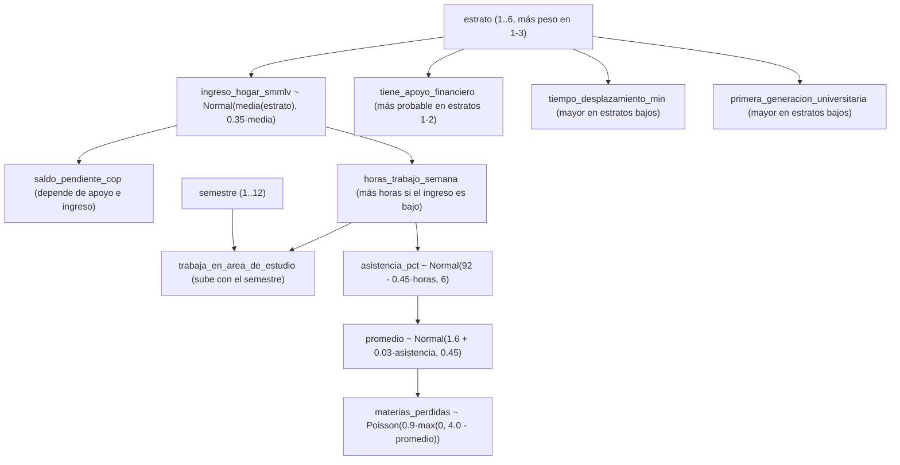

# Manual de estudio — Simulador de probabilidad de deserción

Este manual sirve para **entender el proyecto de principio a fin** y poder
explicarlo con total solvencia en la sustentación. Todo lo que dice se comprobó
contra el código real y contra la base de datos de referencia (`data/simulador.db`).
Si algo del manual contradice el código, manda el código.

Documentos complementarios: [`justificacion_modelo.md`](justificacion_modelo.md),
[`contrato_simulador.md`](contrato_simulador.md), [`guia_sustentacion.md`](guia_sustentacion.md).

---

## 0. Hoja de ruta rápida ("Cheat Sheet" para el día de la defensa)

> [!IMPORTANT]
> **Las 6 cifras y verdades que debes saber de memoria (n = 500, semilla = 42):**
> 1. **Modelo de riesgo:** Regresión logística sobre 4 subpuntajes `s_d ∈ [0, 1]`. Montecarlo **no** es el modelo (solo muestrea la cohorte y la incertidumbre P5–P95).
> 2. **Calibración (`b₀`):** `b₀ = −4.947534`, despejado por bisección para que la probabilidad media sea exactamente `9.00%` (tasa base semestral, diferencia `6.1 × 10⁻⁹`).
> 3. **Distribución por nivel:** Bajo `83.92%` (407) · Medio `13.61%` (66) · Alto `2.47%` (12) sobre `485` válidos.
> 4. **Intervención:** `15.26%` (**74 de 485** válidos requieren acompañamiento).
> 5. **Revisión humana (Paso 1):** **15 de 500** (`3%` inyectado: 5 campo vacío, 5 fuera de rango, 5 contradicción — incluidos `UNA-0206` y `UNA-0479` del **caso A03**).
> 6. **Hallazgo de sensibilidad:** El supuesto más influyente **no** es el coeficiente mayor (`bA = 3.0`, amplitud `3.22 pp`) sino el **financiero** (`bF = 2.5`, amplitud **`10.13 pp`**), porque en la cohorte `s̄F = 0.43` frente a `s̄A = 0.11`.

---

## 1. La idea en 30 segundos

Una universidad quiere saber **a qué estudiantes acompañar este semestre y con
qué**. El simulador:

1. Genera una **cohorte sintética** de estudiantes (ninguno es real, por privacidad).
2. **Valida** cada registro (Paso 1); si es dudoso o contradictorio, **no calcula ninguna probabilidad** y lo envía a revisión humana.
3. Calcula **cuatro subpuntajes** de riesgo (`sA`, `sF`, `sL`, `sP` en `[0, 1]`).
4. Los combina con una **regresión logística** calibrada y obtiene una probabilidad de deserción semestral `p` junto con su intervalo de incertidumbre **P5–P95** (Paso 2).
5. Decide si el estudiante **requiere intervención** y arma un plan priorizado según la causa raíz (Paso 3).
6. Guarda todo en **SQLite** y lo presenta en una **interfaz web interactiva** (con filtros, buscador por código, exportación a CSV y simulador *What-If*).

```
E ──> [Paso 1: validar] ──> [Paso 2: riesgo] ──> [Paso 3: intervención]
        validacion.py         riesgo.py             intervencion.py
                              incertidumbre.py
```

---

## 2. Mapa del proyecto y orden de lectura

| Archivo | Qué hace | Estudiar si te preguntan por… |
|---|---|---|
| [`config.py`](../config.py) | **Todos** los parámetros del modelo en un solo lugar | supuestos, pesos, saturaciones, umbrales |
| [`modelo/__init__.py`](../modelo/__init__.py) | `simular()`: orquesta toda la cadena de principio a fin | el flujo completo de una corrida |
| [`modelo/generador.py`](../modelo/generador.py) | Montecarlo 1: cohorte sintética + topes + errores inyectados | de dónde salen los datos y el caso A03 |
| [`modelo/validacion.py`](../modelo/validacion.py) | Paso 1: validación estricta | errores, contradicciones, `NaN` (caso E15), booleanos |
| [`modelo/riesgo.py`](../modelo/riesgo.py) | Paso 2: subpuntajes, logística, calibración de `b₀` | las ecuaciones exactas |
| [`modelo/incertidumbre.py`](../modelo/incertidumbre.py) | Montecarlo 2: intervalo P5–P95 (`K = 1000`) | qué mide y qué **no** mide el intervalo |
| [`modelo/intervencion.py`](../modelo/intervencion.py) | Paso 3: regla de decisión y plan priorizado | quién recibe qué apoyo y en qué orden |
| [`modelo/sensibilidad.py`](../modelo/sensibilidad.py) | Validación del modelo (4 comprobaciones) | cómo demostramos que el modelo es coherente |
| [`db.py`](../db.py), [`schema.sql`](../schema.sql) | Persistencia SQLite en 3 tablas | por qué los inválidos no tienen fila en `resultados` |
| [`app.py`](../app.py) | Servidor Flask: API JSON y validación HTTP | endpoints y códigos 200/201/400/404 |
| [`static/`](../static/) | `index.html`, `app.js`, `styles.css` | gráficas SVG offline, buscador, CSV y evaluador *What-If* |
| [`tests/`](../tests/) | **340 pruebas** automatizadas en 6 archivos | cobertura unitaria, API, persistencia y estrés |

**Orden recomendado para leer el código:**
`config.py` → `validacion.py` → `riesgo.py` → `intervencion.py` → `incertidumbre.py` → `generador.py` → `modelo/__init__.py` → `db.py` → `app.py`.

---

## 3. Paso 1 — Validar el registro (`modelo/validacion.py`)

Cada estudiante entra como un diccionario `E` con **14 campos obligatorios** repartidos en 4 dimensiones:

| Dimensión | Campo | Tipo | Rango cerrado válido |
|---|---|---|---|
| **Académica** | `promedio` | decimal | `0.0` a `5.0` |
| | `materias_perdidas` | entero | `0` a `8` |
| | `asistencia_pct` | decimal | `0.0` a `100.0` |
| | `semestre` | entero | `1` a `12` |
| **Financiera** | `saldo_pendiente_cop` | entero (COP) | `0` a `20.000.000` |
| | `ingreso_hogar_smmlv` | decimal | `0.0` a `20.0` |
| | `estrato` | entero | `1` a `6` |
| | `tiene_apoyo_financiero` | booleano | `True` / `False` |
| **Laboral** | `horas_trabajo_semana` | decimal | `0.0` a `60.0` |
| | `trabaja_en_area_de_estudio` | booleano | `True` / `False` |
| **Personal** | `tiempo_desplazamiento_min` | entero | `0` a `240` |
| | `personas_a_cargo` | entero | `0` a `6` |
| | `apoyo_familiar` | entero | `1` a `5` |
| | `primera_generacion_universitaria` | booleano | `True` / `False` |

### Orden estricto de evaluación (el primero que falle detiene el paso)

Si el registro falla en cualquiera de estas 4 compuertas, **no recibe probabilidad** y devuelve `decision = "requiere_revision_humana"`:

1. **`campo_faltante`**: falta una clave del diccionario, su valor es `None` o es un string vacío/en blanco (`""`, `"   "`).
2. **`tipo_invalido`**: el tipo no coincide (ej. `"4.5"` como string, `4.0` en un campo entero, `1` en un booleano) o es un decimal no finito (`NaN`, `+inf`, `-inf`).
3. **`fuera_de_rango`**: el número está fuera de `[min, max]`. Los extremos exactos sí son válidos.
4. **`datos_contradictorios`**: cada campo individual está en rango, pero la combinación es imposible:
   - `estrato >= 5` y `ingreso_hogar_smmlv < 1.0` → reporta campo `estrato_ingreso`.
   - `estrato <= 2` y `ingreso_hogar_smmlv > 10.0` → reporta campo `estrato_ingreso` (**Caso A03**, el hueco detectado en la entrega anterior y ahora cerrado).
   - `materias_perdidas > 0` y `promedio == 5.0` → reporta campo `promedio_materias_perdidas`.

### Dos detalles técnicos clave de `validacion.py` para lucirse en la defensa

- **El hueco de `NaN` (Caso E15 de `test_estres.py`):** en Python, `isinstance(float("nan"), float)` es `True`, y tanto `NaN < 0` como `NaN > 5` devuelven `False`. Sin cuidado, un `NaN` burla el chequeo de rango y contamina toda la fórmula logística. Por eso `_es_numero()` exige `math.isfinite(valor)`.
- **Por qué `bool` no pasa como `int`:** en Python, la clase `bool` hereda de `int` (`isinstance(True, int)` es `True` y `True == 1`). Por eso `_es_entero()` verifica explícitamente `isinstance(valor, int) and not isinstance(valor, bool)`.

---

## 4. Paso 2 — Calcular el riesgo (`modelo/riesgo.py` e `incertidumbre.py`)

### 4.1 Subpuntajes por dimensión (`s_d ∈ [0, 1]`)

Cada subpuntaje es un promedio ponderado de variables normalizadas a `[0, 1]` (0 = sin riesgo, 1 = riesgo máximo). Como los pesos de cada dimensión suman `1.0`, el subpuntaje nunca sale de `[0, 1]`:

```
sA = 0.40·(1 − promedio/5) + 0.30·min(perdidas/3, 1) + 0.30·(1 − asistencia/100)

sF = 0.35·min(saldo/8.000.000, 1) + 0.30·(1 − min(ingreso/4, 1))
     + 0.20·((6 − estrato)/5) + 0.15·(0 si tiene apoyo, 1 si no)

sL = 0.70·i + 0.30·i·(0 si trabaja en su área, 1 si no),   con i = min(horas/40, 1)

sP = 0.30·min(desplazamiento/120, 1) + 0.25·min(personas/3, 1)
     + 0.30·((5 − apoyo_familiar)/4) + 0.15·(1 si primera generación, 0 si no)
```

- **Por qué hay saturaciones (`min(x/tope, 1)`):** a partir de cierto punto (perder 3 materias, deber 8 millones, ganar 4 SMMLV, trabajar 40 h, viajar 120 min o tener 3 personas a cargo), el efecto marginal sobre esa variable ya es máximo (`1.0`).
- **Por qué en `sL` la desalineación multiplica a `i`:** si un estudiante no trabaja (`horas = 0` → `i = 0`), tiene `trabaja_en_area_de_estudio = False`. Si no se multiplicara por `i`, recibiría `0.30` de riesgo laboral sin trabajar.

### 4.2 Probabilidad de deserción por Regresión Logística

```
z = b₀ + 3.0·sA + 2.5·sF + 1.5·sL + 1.2·sP
p = 1 / (1 + exp(−z))
```

- **Estabilidad numérica:** `logistica(z)` usa `1 / (1 + exp(-z))` cuando `z >= 0` y `exp(z) / (1 + exp(z))` cuando `z < 0`, evitando `OverflowError` con números extremos.
- **Cómo se calibra `b₀` (no se inventa):** `calibrar_b0()` busca por **bisección** en `[-20, 20]` (hasta 200 iteraciones, tolerancia `10⁻⁶`) el único valor de `b₀` que hace que el promedio de `p` en los estudiantes válidos coincida con `tasa_base_semestral` (`0.09`). Como `media(b₀)` es estrictamente creciente con `b₀`, la bisección converge siempre.

### 4.3 Contribuciones, factor principal, problemas y nivel

- **Contribución de la dimensión `d`:** `contrib[d] = b_d · s_d` (cuánto empuja esa dimensión el logit `z` hacia arriba).
- **Factor principal:** la dimensión con mayor contribución `b_d · s_d` (en caso de empate exacto, gana el orden `academica`, `financiera`, `laboral`, `personal`).
- **Problemas activos:** lista de dimensiones donde `s_d >= 0.60` (`UMBRAL_PROBLEMA`), ordenadas de mayor a menor subpuntaje (`s_d`).
- **Nivel de riesgo:**
  - `p >= 0.35` → `"alto"`
  - `0.15 <= p < 0.35` → `"medio"`
  - `p < 0.15` → `"bajo"`

### 4.4 Ejemplo completo paso a paso (verificable en la pestaña *What-If*)

Perfil "Estudiante típico" (botón rápido 1 del Evaluador *What-If*):
`promedio = 3.0`, `perdidas = 2`, `asistencia = 80%`, `semestre = 4`, `saldo = $4.000.000`, `ingreso = 2.0 SMMLV`, `estrato = 2`, `apoyo = False`, `horas = 30`, `en_area = False`, `desplazamiento = 60 min`, `personas = 1`, `apoyo_familiar = 3`, `primera_gen = True`.

| Dimensión | Cálculo del subpuntaje `s_d` | `s_d` | Coef. `b_d` | Aporte `b_d · s_d` | ¿Problema (`≥ 0.60`)? |
|---|---|---|---|---|---|
| **Académica** | `0.40·(2/5) + 0.30·(2/3) + 0.30·(20/100) = 0.16 + 0.20 + 0.06` | **0.420** | 3.0 | 1.2600 | No |
| **Financiera** | `0.35·(4/8) + 0.30·(1 − 2/4) + 0.20·(4/5) + 0.15·1 = 0.175 + 0.15 + 0.16 + 0.15` | **0.635** | 2.5 | **1.5875** | **Sí** |
| **Laboral** | `i = 30/40 = 0.75` → `0.70·0.75 + 0.30·0.75·1` | **0.750** | 1.5 | 1.1250 | **Sí** |
| **Personal** | `0.30·(60/120) + 0.25·(1/3) + 0.30·(2/4) + 0.15·1 = 0.15 + 0.0833 + 0.15 + 0.15` | **0.533** | 1.2 | 0.6400 | No |

1. **Logit `z`:** `-4.947534 + 1.2600 + 1.5875 + 1.1250 + 0.6400 = -0.335034`
2. **Probabilidad `p`:** `1 / (1 + exp(0.335034)) = 0.4170` (**41.7%**) → Nivel **alto** (`≥ 0.35`).
3. **Factor principal vs. mayor subpuntaje:** aunque el subpuntaje más alto es `laboral` (`0.750`), el **factor principal** es **`financiera`** porque `2.5 × 0.635 = 1.5875 > 1.5 × 0.750 = 1.1250`. Por eso la prioridad 1 de intervención es el **Plan de apoyo financiero** y la prioridad 2 es **Flexibilidad horaria**.

### 4.5 Propagación de incertidumbre — Montecarlo 2 (`modelo/incertidumbre.py`)

Como los coeficientes `b_d` son supuestos expertos, se sortean `K = 1000` vectores de coeficientes usando una semilla separada (`semilla + 1_000_003`):

```
b_d^(k) ~ max(0, Normal(b_d, 0.25 · b_d))
```

Para cada estudiante válido se calculan las 1000 probabilidades (manteniendo `b₀` fijo en su valor calibrado) y se extraen los percentiles **P5** y **P95** por interpolación lineal.

---

## 5. Paso 3 — Decisión y plan de intervención (`modelo/intervencion.py`)

### Regla de decisión

```
requiere_intervencion = (nivel == "alto")  o  (nivel == "medio" y len(problemas) > 0)
```

- Un estudiante de nivel **bajo** (`p < 0.15`) **nunca** recibe intervención, aunque tenga una dimensión con `s_d >= 0.60` (focalización de recursos).
- Un estudiante de nivel **medio** solo recibe intervención si tiene al menos una dimensión crítica (`s_d >= 0.60`). En la simulación de referencia hay **4 estudiantes de nivel medio sin ninguna dimensión `>= 0.60`** (por ejemplo `UNA-0065` con `p = 0.156` y `UNA-0079` con `p = 0.168`), por eso de `12 altos + 66 medios = 78`, solo **74** requieren intervención.

### Orden de prioridad y caso de borde

1. Si el `factor_principal` está dentro de `problemas`, va en **Prioridad 1**, seguido de las demás dimensiones problemáticas en orden de `s_d`.
2. Si el estudiante es de nivel **alto** pero su riesgo está repartido entre las 4 dimensiones sin que ninguna alcance `0.60` (`problemas == []`), el sistema le asigna como única intervención la de su **`factor_principal`** para que ningún estudiante en riesgo alto quede con un plan vacío.

---

## 6. Cómo se genera la cohorte sintética (`modelo/generador.py`)

### 6.1 Grafo de dependencias entre variables (Montecarlo 1)

Las variables no se generan sueltas, sino siguiendo una cadena causal plausible a partir del estrato y el semestre:



- La distribución de Poisson se implementó desde cero con el **algoritmo de Knuth** (`_poisson()`) usando únicamente `math.exp` y `random` de la librería estándar.
- **Topes anti-contradicción en registros sanos:** para que el muestreo aleatorio normal no cree por accidente una contradicción del Paso 1, `generar_registro()` aplica tres topes:
  1. Si `estrato >= 5`, fuerza `ingreso >= 1.05`.
  2. Si `estrato <= 2`, fuerza `ingreso <= 9.5`.
  3. Si `materias_perdidas > 0` y `promedio == 5.0`, baja `promedio` a `4.9`.

### 6.2 Inyección controlada del 3% de errores y el bug real del módulo 3

Después de crear los `n = 500` registros sanos, `generar_cohorte()` elige `15` posiciones al azar (con el mismo `rng` para que sean 100% reproducibles) y les inyecta los 3 tipos de fallo en rotación (`campo_vacio`, `fuera_de_rango`, `contradiccion`, 5 de cada uno).

> [!TIP]
> **Anécdota técnica para contar en la sustentación (`generador.py#L167-L170`):**
> Al principio, la función `_danar_registro()` elegía qué contradicción meter usando `indice % 3`. Como el tipo de error también rotaba con `indice % 3` (entre los 3 tipos de error), ¡`contradiccion` caía siempre en el mismo residuo y **el caso A03 nunca se generaba**! La prueba `test_generador.py` detectó el problema y se corrigió pasando `vuelta = indice // 3` (contando las vueltas *dentro de cada tipo*).

---

## 7. Casos reales de la base de datos (`semilla = 42`) para mostrar en vivo

Con el nuevo **buscador por código** de la interfaz, puedes escribir cualquiera de estos códigos durante la defensa y abrirlo al instante:

| Código | Qué caso representa | Valores clave |
|---|---|---|
| **`UNA-0025`** | **El estudiante de mayor riesgo de toda la cohorte** (`p = 55.2%`, P5–P95: `28.9%–80.0%`) | Nivel `alto`. Subpuntajes: `sA=0.56`, `sF=0.58`, `sL=0.97`, `sP=0.49`. Curiosidad: su único problema `≥ 0.60` es `laboral` (`0.97`), pero su **factor principal** es `academica` (`3.0 × 0.5556 = 1.667 > 1.5 × 0.965 = 1.448`). |
| **`UNA-0394`** | **Segundo mayor riesgo, crisis financiera y laboral** (`p = 49.5%`) | Nivel `alto`. Problemas: `laboral` (`sL=1.00`) y `financiera` (`sF=0.95`). Factor principal: `financiera` (Prioridad 1: Plan de apoyo financiero, Prioridad 2: Flexibilidad horaria). |
| **`UNA-0065`** | **Nivel medio que NO requiere intervención** (`p = 15.6%`) | Supera `0.15`, pero ninguna de sus 4 dimensiones llega a `0.60` (`problemas = []`). Demuestra la regla del Paso 3. |
| **`UNA-0206`** y **`UNA-0479`** | **Caso A03 inyectado (Paso 1)** | `estrato = 1` con `ingreso = 14.0 SMMLV`. Rechazados con `datos_contradictorios` en `estrato_ingreso`. Sin probabilidad. |
| **`UNA-0252`** | **Contradicción académica (Paso 1)** | `promedio = 5.0` con `materias_perdidas = 1`. Rechazado con `datos_contradictorios` en `promedio_materias_perdidas`. |
| **`UNA-0012`** y **`UNA-0024`** | **Campo faltante y fuera de rango (Paso 1)** | `UNA-0012` tiene `promedio = None` (`campo_faltante`); `UNA-0024` tiene `promedio = 6.3` (`fuera_de_rango`). |

---

## 8. Validación del modelo (`modelo/sensibilidad.py`)

Se ejecuta automáticamente en cada simulación y aparece en la pestaña **Validación del modelo**:

| Comprobación | Qué verifica | Resultado en `semilla = 42` |
|---|---|---|
| **1. Calibración** | `\|media(p) − tasa_base\| <= 0.005` | `0.090000` vs `0.090000` (dif. `6.1 × 10⁻⁹`) ✔ |
| **2. Sensibilidad** | Mueve cada `b_d` un `±50%` dejando `b₀` fijo | Financiera `10.13 pp` · Laboral `5.00 pp` · Personal `3.79 pp` · Académica `3.22 pp` |
| **3. Validez de cara** | Evalúa 3 perfiles arquetípicos (`sin_riesgo`, `riesgo_solo_financiero`, `todo_alto`) | `3 / 3` coinciden con el nivel, problemas e intervención esperados ✔ |
| **4. Monotonía** | Recorre las 13 variables de entrada de mejor a peor valor y verifica que `p` nunca baje | `13 / 13` variables monótonas ✔ |
| **5. Validación empírica real (Dataset UCI, `modelo/datos_reales.py`)** | Evalúa los `3.630` estudiantes reales con desenlace cerrado (`1.421 Dropout` / `2.209 Graduate`) del dataset UCI (Realinho et al., 2022) | **AUC–ROC = `0.8936`** · `p` media en desertores `55.15%` vs graduados `28.85%` · **`473` tutorías académicas activadas** ✔ |

---

## 9. Persistencia (`db.py`, `schema.sql`), API (`app.py`) e Interfaz Web (`static/`)

### 9.1 Tres tablas en SQLite (`data/simulador.db`)

- `simulaciones`: guarda parámetros, `b0_calibrado`, `indice_general`, conteos y los JSON de resumen y validación.
- `estudiantes`: guarda los 500 registros con `datos_json`, `valido` (`1` o `0`), `motivo_revision`, `campo_revision` y `error_inyectado`.
- `resultados`: tiene clave primaria `estudiante_id` y **solo almacena filas para los estudiantes válidos** (`485` filas). Así la base de datos garantiza por diseño que un registro inválido no tenga probabilidad.
- **Seguridad contra inyección SQL:** todas las consultas usan parámetros `?`, los nombres de dimensión se validan contra `config.DIMENSIONES` y el `ORDER BY` usa una lista blanca cerrada (`_ORDENES`).

### 9.2 Herramientas de la Interfaz Web (`http://127.0.0.1:5000`)

1. **Carga automática al iniciar:** al abrir la página, carga automáticamente la última simulación guardada en SQLite (`#1`) sin necesidad de volver a simular.
2. **Pestaña "Resultados":**
   - 6 tarjetas de indicadores, histograma SVG con líneas de umbral y gráfica SVG de contribución media `b_d · s̄_d`.
   - Tabla interactiva con filtros combinables (nivel, intervención, dimensión problemática, solo revisión humana), **buscador instantáneo por código (`UNA-xxxx`)** y botón **Exportar CSV** (descarga la vista filtrada actual con BOM UTF-8 para abrir en Excel).
   - Al hacer clic en cualquier fila se despliega el panel de detalle con la barra del intervalo P5–P95 y el plan de intervención.
3. **Pestaña "Evaluador individual (What-If)":**
   - Permite modificar en vivo las 14 variables de un estudiante y ver al instante cómo responden el Paso 1, el Paso 2 y el Paso 3.
   - Trae **6 botones de perfiles rápidos**: *Estudiante típico*, *Sin riesgo*, *Crisis financiera*, *Riesgo extremo (4 dim., que activa `tutoria_academica`)*, *Contradicción A03* y *Promedio 5.0 con pérdidas*.
4. **Pestaña "Validación del modelo":** muestra en tablas las 4 pruebas de `sensibilidad.py`.
5. **Pestaña "Historial":** lista todas las corridas guardadas en SQLite y permite reabrir cualquiera con un clic.

---

## 10. Limitaciones conocidas y pendientes académicos (transparencia total)

Mencionar estas limitaciones por iniciativa propia demuestra madurez metodológica:

1. **Los parámetros son supuestos (`[SUPUESTO]`):** la tasa base semestral (`9%`), los coeficientes (`3.0, 2.5, 1.5, 1.2`), los pesos internos, los topes de saturación, los umbrales (`0.15, 0.35, 0.60`) y el `25%` de dispersión de Montecarlo son juicio experto, no estimaciones empíricas.
2. **La cohorte de referencia no emite `tutoria_academica`:** ningún estudiante válido de la semilla 42 supera `sA >= 0.60` (porque exige fallar a la vez en promedio, materias perdidas y asistencia). **No se alteraron las distribuciones para forzar tutorías**, porque maquillar la entrada para obtener la salida deseada invalida la simulación. En el **Evaluador What-If** (botón *Riesgo extremo*) se puede comprobar que la regla de `tutoria_academica` sí se activa cuando `sA >= 0.60`.
3. **El campo `semestre` no entra en las fórmulas de riesgo:** participa en el Paso 1 y en la generación de `trabaja_en_area_de_estudio`, pero no suma en `sA`.
4. **Un perfil exclusivamente financiero con las demás dimensiones en `0.0` da `p ≈ 0.08` (nivel bajo):** porque `2.5 × 1.0 − 4.9475 = −2.4475` no alcanza el umbral medio (`0.15`). El modelo exige al menos riesgo basal en las otras dimensiones para escalar a nivel medio/alto.
5. **El intervalo P5–P95 solo mide incertidumbre en los coeficientes (`±25%`):** no mide incertidumbre estructural ni falta de datos reales.
6. **Fuentes oficiales y bibliografía verificadas (`[OK]` en `Calibracion Y FUentes/`):**
   - **SPADIES 3.0 (MEN, corte 2024):** Tasa de deserción anual (TDA) universitaria = **8,65%** ($\implies p_{\text{sem}} = 1 - \sqrt{1 - 0,0865} \approx \mathbf{4,42\%}$), deserción acumulada a semestre 10 = **22,61%**.
   - **Distribuciones nacionales (`[OK]`):** estratos en Saber Pro (`16%, 35%, 33%, 10%, 4%, 2%`, Informe LEE 15 PUJ), clases de ingreso DANE 2024 (vulnerable $\le 2,14$ SMMLV, media hasta $11,5$ SMMLV), ocupación estudiantil (25,3% general DANE 2025; 70–81% en último año Saber Pro, Chaparro & Briceño 2025), Gratuidad en IES públicas (939.282 beneficiarios = 97% pregrado público, MEN 2025).
   - **Citas teóricas y empíricas (`[OK]`):** Tinto (1975, *Rev. Educ. Res.*, 45(1), 89–125), Bean & Metzner (1985, *Rev. Educ. Res.*, 55(4), 485–540), Tapasco-Alzate et al. (2019, U. de Caldas), Arismendy Fuentes et al. (2020, U. de los Llanos), Jordana Schmidt et al. (2023, U. de La Frontera) y tabla de estimación Mendeley Cúcuta (`Tabla_3_estimacion_del_modelo.xlsx`).

---

## 11. Guion sugerido para la demostración en vivo (3 minutos)

1. **Mostrar la pantalla inicial (`Resultados`):** señalar que ya cargó desde SQLite la simulación `#1` (`n=500, semilla=42`) con `Índice = 9.00%` y `b₀ = −4.9475`.
2. **Tabla y buscador:** filtrar por `Intervención = Requiere` (`74` casos) o escribir `UNA-0025` en **Buscar código**; hacer clic en la fila para mostrar el intervalo P5–P95 y el plan priorizado. Luego pulsar **Exportar CSV**.
3. **Revisión humana:** marcar **Solo revisión humana** (`15` casos) y abrir `UNA-0206` para mostrar que el **caso A03** fue bloqueado en el Paso 1 sin recibir probabilidad.
4. **Evaluador individual (*What-If*):** abrir la segunda pestaña y pulsar sucesivamente *Sin riesgo* (`0.8%`), *Crisis financiera* (`21.6%`), *Riesgo extremo* (`92.7%`, donde aparece `Tutoría académica` en Prioridad 1) y *Contradicción A03* (rechazado en vivo).
5. **Validación e Historial:** mostrar la pestaña **Validación del modelo** (la tabla donde Financiera mueve `10.13 pp` frente a `3.22 pp` de Académica) y cerrar en **Historial**.
